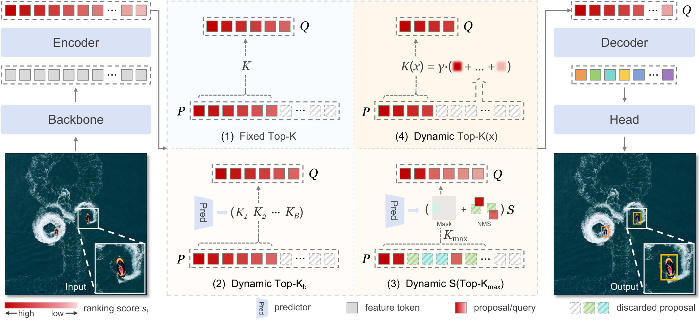

<h1 align="center">Dynamic Query as Budgeting for Tiny Object Detection</h1>

<p align="center">A remarkably simple approach to robust dynamic query budgeting for real-time tiny (and dense) object detection.</p>

<p align="center"><a href="https://zhangyi-magic.github.io/">Yi Zhang</a><sup>1</sup>, Di Xiong<sup>1</sup>, Ge Gao<sup>1</sup>, Xiangyue Zhang<sup>1</sup>, Yihang Qiu<sup>1</sup>, Yuxuan Zhou<sup>1</sup>, and <a href="https://shuochenya.github.io/">Shuo Chen</a><sup>1,2,*</sup><br>
<sup>1</sup> <em>School of Intelligence Science and Technology, Nanjing University, China.</em><br>
<sup>2</sup> <em>Center for Advanced Intelligence Project, RIKEN, Japan.</em><br>
* 📧 Corresponding author: <a href="mailto:shuo.chen@nju.edu.cn">shuo.chen@nju.edu.cn</a></p>

<p align="center"><strong>This repository also supports <a href="https://github.com/RicePasteM/Dome-DETR">Dome-DETR</a>, <a href="https://github.com/Peterande/D-FINE">D-FINE</a>, and <a href="https://github.com/Intellindust-AI-Lab/DEIM">DEIM</a> for tiny object detection.<br>
If you find <a href="https://arxiv.org/abs/2610.33430">BUTR</a> useful, please consider giving this repository a star ⭐.</strong></p>

<p align="center"></p>

<p align="center"><em>BUTR estimates a query budget from encoder confidences, then applies standard Top-K initialization—without additional parameters or supervision.</em> <a href="docs/method.md">Method details</a></p>

## Updates

- [2026.10] Repository created; code refactored; retrained checkpoints coming soon.
- [2026.09] Our paper has been accepted at NeurIPS 2026!

## Main results

AI-TOD-v2 and VisDrone results are obtained with 800 × 800 inputs and four feature levels. For each dataset, BUTR is trained on the `trainval` split and evaluated on the `test` split.

### AI-TOD-v2

| Model | AP | #Params | Latency | GFLOPs | Config | Checkpoint | Log |
| :---: | :---: | :---: | :---: | :---: | :---: | :---: | :---: |
| BUTR-S | 32.7 | 11.6M | 12.23&nbsp;ms | 112.5 | [yml](configs/models/BUTR-S-AITOD.yml) | [32.7](https://github.com/zhangyi-magic/BUTR/releases/download/checkpoints/butr_s_aitodv2.pth) | [url](docs/logs/butr_s_aitodv2.log) |
| BUTR-M | 34.6 | 22.3M | 17.60&nbsp;ms | 244.8 | [yml](configs/models/BUTR-M-AITOD.yml) | | |
| BUTR-L | 35.7 | 31.9M | 20.94&nbsp;ms | 326.1 | [yml](configs/models/BUTR-L-AITOD.yml) | [35.7](https://github.com/zhangyi-magic/BUTR/releases/download/checkpoints/butr_l_aitodv2.pth) | [url](docs/logs/butr_l_aitodv2.log) |

### VisDrone

| Model | AP | #Params | Latency | GFLOPs | Config | Checkpoint | Log |
| :---: | :---: | :---: | :---: | :---: | :---: | :---: | :---: |
| BUTR-S | 26.7 | 11.6M | 13.26&nbsp;ms | 114.9 | [yml](configs/models/BUTR-S-VisDrone.yml) | | [url](docs/logs/butr_s_visdrone.log) |
| BUTR-M | 29.4 | 22.3M | 19.31&nbsp;ms | 245.8 | [yml](configs/models/BUTR-M-VisDrone.yml) | | |
| BUTR-L | 29.8 | 34.5M | 23.76&nbsp;ms | 329.5 | [yml](configs/models/BUTR-L-VisDrone.yml) | | |

GFLOPs and latency are reported as averages. Latency is measured on an NVIDIA Tesla T4 with TensorRT 10.4.0, FP16 enabled, and batch size 1; each result averages three rounds. See [deployment results and comparisons](docs/deployment-results.md) for the protocol and accuracy checks.

<details>
<summary><strong>Sorghum-Grain-Count</strong></summary>

[Sorghum-Grain-Count](https://github.com/swarajksu/sorghum-grain-count), using 800 × 800 nonempty crops with stride 640 (paper Appendix G, Table 11).

| Model | AP | Mean queries |
| :---: | :---: | :---: |
| D-FINE-L | 57.0 | 400 |
| D-FINE-L | 57.7 | 1100 |
| DEIM-L | 57.2 | 400 |
| DEIM-L | 58.0 | 1100 |
| Dome-DETR-L | 57.6 | 1103 |
| BUTR-L | 58.0 | 378 |

[Data preparation and training](docs/grain.md) · [Configs](configs/models/grain/)

</details>

<details>
<summary><strong>COCO inference-time plug-in</strong></summary>

Official D-FINE/DEIM checkpoints with and without BUTR on COCO `val2017`, without retraining.

<table>
  <thead>
    <tr><th align="center">Model</th><th align="center">Variant</th><th align="center">AP</th><th align="center">#Params</th><th align="center">Latency</th><th align="center">GFLOPs</th><th align="center">Queries</th></tr>
  </thead>
  <tbody>
    <tr>
      <td rowspan="2" align="center" valign="middle">D&#8209;FINE&#8209;S</td>
      <td align="center">Baseline</td><td align="center">48.5</td><td align="center">10.2M</td><td align="center">3.63&nbsp;ms</td><td align="center">25.2</td><td align="center">300</td>
    </tr>
    <tr>
      <td align="center">+BUTR</td><td align="center">48.6</td><td align="center">10.2M</td><td align="center">4.24&nbsp;ms</td><td align="center">24.6</td><td align="center">232</td>
    </tr>
    <tr>
      <td rowspan="2" align="center" valign="middle">D&#8209;FINE&#8209;M</td>
      <td align="center">Baseline</td><td align="center">52.3</td><td align="center">19.3M</td><td align="center">5.66&nbsp;ms</td><td align="center">56.7</td><td align="center">300</td>
    </tr>
    <tr>
      <td align="center">+BUTR</td><td align="center">52.4</td><td align="center">19.3M</td><td align="center">6.44&nbsp;ms</td><td align="center">56.6</td><td align="center">289</td>
    </tr>
    <tr>
      <td rowspan="2" align="center" valign="middle">D&#8209;FINE&#8209;L</td>
      <td align="center">Baseline</td><td align="center">54.0</td><td align="center">30.8M</td><td align="center">7.94&nbsp;ms</td><td align="center">91.0</td><td align="center">300</td>
    </tr>
    <tr>
      <td align="center">+BUTR</td><td align="center">54.1</td><td align="center">30.8M</td><td align="center">8.81&nbsp;ms</td><td align="center">90.2</td><td align="center">253</td>
    </tr>
    <tr>
      <td rowspan="2" align="center" valign="middle">D&#8209;FINE&#8209;X</td>
      <td align="center">Baseline</td><td align="center">55.8</td><td align="center">61.6M</td><td align="center">13.52&nbsp;ms</td><td align="center">202.5</td><td align="center">300</td>
    </tr>
    <tr>
      <td align="center">+BUTR</td><td align="center">55.9</td><td align="center">61.6M</td><td align="center">13.84&nbsp;ms</td><td align="center">201.7</td><td align="center">253</td>
    </tr>
    <tr>
      <td rowspan="2" align="center" valign="middle">DEIM&#8209;S</td>
      <td align="center">Baseline</td><td align="center">49.0</td><td align="center">10.2M</td><td align="center">3.75&nbsp;ms</td><td align="center">25.2</td><td align="center">300</td>
    </tr>
    <tr>
      <td align="center">+BUTR</td><td align="center">49.0</td><td align="center">10.2M</td><td align="center">4.32&nbsp;ms</td><td align="center">24.6</td><td align="center">239</td>
    </tr>
    <tr>
      <td rowspan="2" align="center" valign="middle">DEIM&#8209;M</td>
      <td align="center">Baseline</td><td align="center">52.7</td><td align="center">19.3M</td><td align="center">5.73&nbsp;ms</td><td align="center">56.7</td><td align="center">300</td>
    </tr>
    <tr>
      <td align="center">+BUTR</td><td align="center">52.8</td><td align="center">19.3M</td><td align="center">6.38&nbsp;ms</td><td align="center">55.9</td><td align="center">236</td>
    </tr>
    <tr>
      <td rowspan="2" align="center" valign="middle">DEIM&#8209;L</td>
      <td align="center">Baseline</td><td align="center">54.7</td><td align="center">30.8M</td><td align="center">8.07&nbsp;ms</td><td align="center">91.1</td><td align="center">300</td>
    </tr>
    <tr>
      <td align="center">+BUTR</td><td align="center">54.9</td><td align="center">30.8M</td><td align="center">8.83&nbsp;ms</td><td align="center">89.8</td><td align="center">223</td>
    </tr>
    <tr>
      <td rowspan="2" align="center" valign="middle">DEIM&#8209;X</td>
      <td align="center">Baseline</td><td align="center">56.5</td><td align="center">61.7M</td><td align="center">13.78&nbsp;ms</td><td align="center">202.7</td><td align="center">300</td>
    </tr>
    <tr>
      <td align="center">+BUTR</td><td align="center">56.6</td><td align="center">61.7M</td><td align="center">13.71&nbsp;ms</td><td align="center">200.6</td><td align="center">183</td>
    </tr>
  </tbody>
</table>

Baselines use 300 queries; BUTR uses `[100, 500]`. Latency is measured with TensorRT on Tesla T4 and averages three rounds; BUTR uses the split-before-transpose layout. See [safety factors](docs/coco.md#budget-settings) and [COCO setup, evaluation and profiling](docs/coco.md).

</details>

## Installation

```bash
conda create -n BUTR python=3.10 -y
conda activate BUTR
pip install -r requirements.txt
```

See [environment setup and troubleshooting](docs/environment.md) for CUDA and compiler requirements.

## Data preparation

| Dataset | Download | Dataset config |
| :---: | :---: | :---: |
| AI-TOD-v2 | [Images](https://github.com/jwwangchn/AI-TOD#download) · [v2 annotations](https://chasel-tsui.github.io/AI-TOD-v2/) | [aitod_detection.yml](configs/dataset/aitod_detection.yml) |
| VisDrone | [Official downloads](https://github.com/VisDrone/VisDrone-Dataset#task-1-object-detection-in-images) | [visdrone_detection.yml](configs/dataset/visdrone_detection.yml) |

Set image and annotation paths in the dataset YAMLs. See [data preparation](docs/data.md) and [HGNetV2 weight initialization](weight/README.md).

## Training

```bash
CUDA_VISIBLE_DEVICES=0,1,2,3,4,5,6,7 torchrun --nproc_per_node=8 \
  --master_port=7777 train.py -c configs/models/BUTR-L-AITOD.yml --seed 0
```

Select the model YAML for the desired dataset and scale. See [training options](docs/usage.md#training-options) and [baseline protocols](docs/baselines.md).

### Tuning

```bash
CUDA_VISIBLE_DEVICES=0,1,2,3,4,5,6,7 torchrun --nproc_per_node=8 \
  --master_port=7777 train.py -c configs/models/BUTR-L-AITOD.yml --seed 0 \
  -t /path/to/checkpoint.pth --output-dir output/butr_l_aitodv2_tuning
```

Use `-t` to initialize model weights for fine-tuning; use `-r` to resume training from a full training checkpoint.

## Evaluation

```bash
CUDA_VISIBLE_DEVICES=0,1,2,3,4,5,6,7 torchrun --nproc_per_node=8 \
  --master_port=7777 train.py -c configs/models/BUTR-L-AITOD.yml --test-only \
  -r /path/to/checkpoint.pth -u val_dataloader.total_batch_size=8
```

This uses one image per GPU for per-image query statistics. [Evaluation details](docs/usage.md#distributed-evaluation-and-query-counts).

## Inference

Image/video inference uses a single GPU.

```bash
CUDA_VISIBLE_DEVICES=0 python tools/inference/torch_inf.py -c configs/models/BUTR-L-AITOD.yml \
  -r output/butr_l_aitodv2/best_stg2.pth -i /path/to/image.png \
  --device cuda:0 --threshold 0.4 --output output/detections.png
```

[Image/video options](docs/usage.md) · [ONNX and TensorRT deployment](docs/tensorrt.md) · [COCO plug-in evaluation](docs/coco.md)

## Tips

- In our experiments with [official Dome-DETR](https://github.com/RicePasteM/Dome-DETR) as of September 2026, multi-GPU evaluation appeared to include only rank 0’s data, which can inflate validation AP on small datasets such as VisDrone. This repository aggregates all ranks; cross-check upstream evaluation with a single GPU.

## Citation

```bibtex
@inproceedings{zhang2026butr,
  title     = {Dynamic Query as Budgeting for Tiny Object Detection},
  author    = {Zhang, Yi and Xiong, Di and Gao, Ge and Zhang, Xiangyue and
               Qiu, Yihang and Zhou, Yuxuan and Chen, Shuo},
  booktitle = {Advances in Neural Information Processing Systems},
  year      = {2026}
}
```

## Acknowledgments and license

This implementation builds on [Dome-DETR](https://github.com/RicePasteM/Dome-DETR), [D-FINE](https://github.com/Peterande/D-FINE), and [DEIM](https://github.com/Intellindust-AI-Lab/DEIM). Original copyright notices are preserved. See [LICENSE](LICENSE) for the Apache License 2.0.
